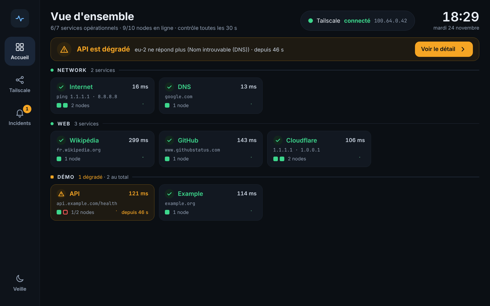
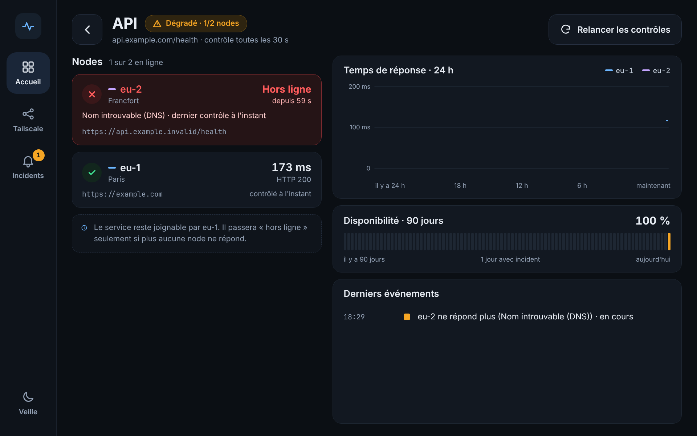
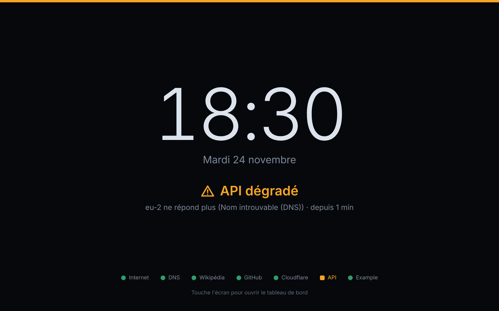

# Tablette de monitoring

Une tablette Android transformée en écran de supervision tactile, verrouillé en plein écran.
Debian tourne dans Termux (proot, **sans root**), un petit serveur Python contrôle les services,
et l'interface s'affiche dans Chromium en mode kiosque.

Testé sur une Lenovo Tab K10 (Android 12, écran 1920 × 1200).



| Détail d'un service | Écran de veille |
|---|---|
|  |  |

*Captures d'une instance de démonstration.*

## Ce que ça fait

- **Contrôles** : HTTP(S) (code attendu, texte attendu, champs JSON attendus), port TCP, ping ICMP
  (sans root) et résolution DNS.
- **Services à plusieurs nodes** : le service est *dégradé* si une node tombe, *hors ligne* si toutes tombent.
  Chaque serveur derrière un même nom peut être interrogé à part (`ip = "…"`, comme `curl --resolve`).
- **Réseaux privés** : résolution par un DNS précis (`resolveur`) et vérification que le contrôle passe
  bien par le tunnel Tailscale (`par_tailscale`), par exemple pour un réseau d'entreprise joint par
  une route de sous-réseau.
- **Tags** : les services sont regroupés par tag sur l'accueil, et les problèmes passent en tête de leur groupe.
  Tout tient sur un écran.
- **Historique** (SQLite) : courbe des temps de réponse sur 24 h, disponibilité sur 30 et 90 jours,
  journal des incidents avec acquittement.
- **Tailscale** : état de la tablette sur le tailnet, alerte si un exit node est activé, et liste des
  appareils si une clé API (lecture) est fournie.
- **Écran de veille** après quelques minutes sans toucher l'écran. Il se rallume sur tout nouvel incident.
- **Verrouillage** : une petite appli Android *device owner* (« Kiosque ») bloque la tablette sur l'écran
  Linux (pas d'accueil Android, pas de notifications). On la pilote en SSH.

Côté serveur, aucune dépendance : uniquement la bibliothèque standard de Python 3.11+.

## Comment c'est monté

```
Android
├── Termux ............. sshd (8022 : Termux, 2222 : Debian), Termux:Boot au démarrage
│   ├── Termux:X11 ..... serveur X plein écran (:0)
│   └── proot Debian
│       ├── kiosk-session ... gestionnaire de fenêtres + relance de l'appli
│       ├── serveur.py ...... contrôles, historique, API JSON (127.0.0.1:8080)
│       └── Chromium ........ --kiosk sur l'interface web
└── Kiosque (device owner) ... verrouillage sur Termux:X11 (lock task)
```

```
monitoring/            serveur, interface web et exemple de configuration
  serveur.py           contrôles + API + fichiers statiques
  web/                 interface (HTML/CSS/JS, sans framework)
  lancer.sh            démarre le serveur puis Chromium en kiosque
  config.example.toml  exemple commenté de toutes les options
tablette/termux/       scripts côté Termux (démarrage, SSH, commande kiosk)
tablette/debian/       scripts côté Debian (session X, relance de l'appli)
kiosque/               sources de l'appli Android de verrouillage (compilée sur la tablette)
```

## Installation

Les étapes ci-dessous résument ce qui a été fait sur la tablette. Elles supposent un accès
`adb` depuis un PC.

### 1. Applis Android

Installer **Termux**, **Termux:X11** et **Termux:Boot**, depuis F-Droid ou les versions GitHub (pas le Play Store).
Ouvrir Termux:Boot une fois pour qu'il s'active.

### 2. Termux

```sh
pkg install openssh proot-distro x11-repo termux-tools
pkg install termux-x11-nightly
proot-distro install debian
```

Copier les scripts :

| Fichier du dépôt | Destination (Termux) |
|---|---|
| `tablette/termux/linux-start`, `linux-stop`, `debian-ssh`, `plein-ecran-auto` | `~/bin/` |
| `tablette/termux/kiosk` | `$PREFIX/bin/kiosk` |
| `tablette/termux/boot/00-linux` | `~/.termux/boot/00-linux` |
| `tablette/termux/sshd_config.extrait` | à ajouter à `$PREFIX/etc/ssh/sshd_config` |

Ajouter ta clé publique SSH dans `~/.ssh/authorized_keys` (Termux) et dans `/root/.ssh/authorized_keys` (Debian).
La connexion par mot de passe est désactivée.

### 3. Debian

```sh
proot-distro login debian
apt install python3 chromium fonts-inter fonts-jetbrains-mono curl \
            matchbox-window-manager x11-utils x11-xserver-utils openssh-server locales
```

| Fichier du dépôt | Destination (Debian) |
|---|---|
| `tablette/debian/kiosk-session`, `kiosk-restart` | `/usr/local/bin/` |
| `tablette/debian/kiosk-app.sh` | `/root/kiosk-app.sh` |
| `monitoring/` | `/root/monitoring/` |

```sh
cd /root/monitoring
cp config.example.toml config.toml   # puis mettre tes services
```

### 4. Appli Kiosque (verrouillage)

Elle se compile directement dans Termux :

```sh
pkg install aapt apksigner d8 openjdk-21
cp -r kiosque ~/kiosque-src && bash ~/kiosque-src/build.sh    # produit ~/kiosque.apk
```

`build.sh` génère un jeton de contrôle et une clé de signature dans `~` (`.kiosk-token`, `.kiosk-keypass`,
`.kiosk.keystore`). Ces fichiers restent sur la tablette.

Depuis le PC (la tablette ne doit avoir **aucun compte** configuré pour devenir *device owner*) :

```sh
adb install -t kiosque.apk
adb shell dpm set-device-owner fr.tablette.kiosque/.Admin
```

Redémarrer la tablette : tout se lance seul et l'écran est verrouillé sur le monitoring.

## Utilisation

```sh
ssh -p 2222 root@<tablette>          # Debian
kiosk-restart                        # relance l'appli après une modification de config.toml

ssh -p 8022 <tablette> kiosk status        # état du verrouillage
ssh -p 8022 <tablette> kiosk unlock        # rend Android (Wi-Fi, réglages...)
ssh -p 8022 <tablette> kiosk lock          # reverrouille
ssh -p 8022 <tablette> kiosk release       # retire définitivement le mode kiosque
ssh -p 8022 <tablette> kiosk plein-ecran   # remasque les barres Android
```

Pour voir l'interface depuis un PC : `ssh -L 8080:127.0.0.1:8080 -p 2222 root@<tablette>`, puis http://localhost:8080.

Journaux : `/root/monitoring/serveur.log` et `chromium.log` (Debian), `~/linux-start.log` et `~/kiosk.log` (Termux).

## Configuration

Tout est dans `monitoring/config.toml`. Le fichier [`config.example.toml`](monitoring/config.example.toml)
décrit chaque option, avec un exemple pour chacune. En bref :

```toml
[[service]]
nom = "API"
tag = "Mes services"
adresse = "api.exemple.fr/health"
nodes = [
  { nom = "srv1", url = "https://api.exemple.fr/health", ip = "203.0.113.10", json = { status = "ok" } },
  { nom = "srv2", url = "https://api.exemple.fr/health", ip = "203.0.113.20", json = { status = "ok" } },
]
```

## Tailscale (facultatif)

- Installer l'appli Android Tailscale, la mettre en **VPN permanent** et l'exclure de l'optimisation de la batterie.
- Dans Debian, mettre `nameserver 100.100.100.100` en tête de `/etc/resolv.conf` pour utiliser MagicDNS.
- Dans `config.toml`, section `[tailscale]` : `actif = true`. Pour la liste des appareils, ajouter une clé API
  dans `cle_api`. Une clé en lecture suffit.
- Pour joindre un réseau privé **sans** faire passer tout le trafic par un exit node, il faut que la machine de
  ce réseau annonce une route de sous-réseau. On marque ensuite les nodes concernées avec `par_tailscale = true`.

## Limites

Debian tourne dans proot, sans root Android :

- pas de systemd : tout est lancé par des scripts ;
- pas de ports en dessous de 1024 ;
- pas de Docker ni d'accélération GPU ;
- Chromium doit être lancé avec `--no-sandbox`.

Termux:X11 laisse parfois les barres Android visibles quand la fenêtre de Chromium est recréée. `plein-ecran-auto` les
remasque à chaque relance de l'appli.

## Licence

MIT, voir [LICENSE](LICENSE).
